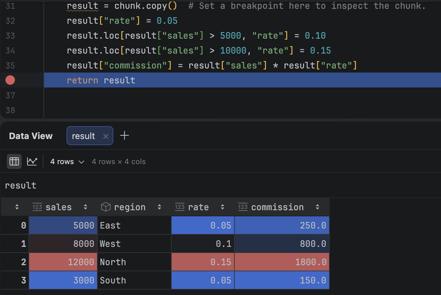

.. _udf_debugging:

Debugging UDFs
==============

Viewing remote logs
-------------------

View UDF execution logs in Logview. **StdOut** shows text printed by the
function, and **StdErr** shows errors and warnings. To record input, intermediate
values, or output, use ``print(..., flush=True)`` inside the UDF so printed
messages are written immediately.

Find the DAG containing the UDF in Logview and click its **Detail** icon.
The next steps depend on the Sub DAG's execution engine: follow
:ref:`udf_debugging_dpe` or :ref:`udf_debugging_mcsql` below.
The navigation screenshots were captured in the MaxCompute console's
Logview, using this example on each engine. Log text is shown below the code.

For the Logview hierarchy and controls, see :doc:`../general/logview`.

The following example uses three orders to show how to find invalid input.
Order ``1002`` has the price ``"invalid"``, which cannot be converted to a
number. The function prints the input types, the number of invalid rows, and up
to three affected order IDs.

.. code-block:: python

   import os

   import pandas as pd
   from odps import ODPS

   import maxframe.dataframe as md
   from maxframe.config import option_context
   from maxframe.session import new_session

   o = ODPS(
       os.environ["ALIBABA_CLOUD_ACCESS_KEY_ID"],
       os.environ["ALIBABA_CLOUD_ACCESS_KEY_SECRET"],
       project=os.environ["ODPS_PROJECT"],
       endpoint=os.environ["ODPS_ENDPOINT"],
   )
   session = new_session(o)
   print(session.get_logview_address())

   sample = md.DataFrame(
       pd.DataFrame(
           {
               "order_id": [1001, 1002, 1003],
               "price": ["12.5", "invalid", "8.0"],
               "quantity": [2, 1, 3],
           }
       )
   )

   def calculate_total(chunk: pd.DataFrame) -> pd.DataFrame[
       {"order_id": "int64", "total": "float64", "valid": "bool"}
   ]:
       print(
           f"rows={len(chunk)}, dtypes={chunk.dtypes.astype(str).to_dict()}",
           flush=True,
       )

       price = pd.to_numeric(chunk["price"], errors="coerce")
       quantity = pd.to_numeric(chunk["quantity"], errors="coerce")
       invalid = price.isna() | quantity.isna()

       print(
           f"invalid_rows={int(invalid.sum())}, "
           f"sample_order_ids={chunk.loc[invalid, 'order_id'].head(3).tolist()}",
           flush=True,
       )

       result = chunk[["order_id"]].copy()
       result["total"] = price * quantity
       result["valid"] = ~invalid

       print(f"output_rows={len(result)}", flush=True)
       return result

   try:
       totals = sample.mf.apply_chunk(
           calculate_total,
           index=sample.index,
       )
       with option_context({"local_execution.enabled": False}):
           totals.execute(session=session)
   finally:
       session.destroy()

Set the connection environment variables before running the example.
The ``option_context`` block disables automatic local execution so that
``execute`` submits this small sample and the UDF to the remote session.
The previous setting is restored when the block exits. Otherwise, if automatic
local execution is enabled, the sample can run on the client and its logs will
not appear in Logview.
Open the printed Logview URL to inspect the logs.
If all three rows arrive in one call, StdOut contains lines like these:

.. code-block:: text

   rows=3, dtypes={'order_id': 'int64', 'price': 'object', 'quantity': 'int64'}
   invalid_rows=1, sample_order_ids=[1002]
   output_rows=3

The engine can split the sample into several calls. This changes the ``rows``
and ``output_rows`` values and the number of log groups. Find the
call that reports ``sample_order_ids=[1002]``.
The displayed dtypes can also vary with the runtime's pandas version and
data conversion. In the runs shown here, ``price`` has dtype ``object``.

This example uses ``pd.to_numeric(..., errors="coerce")`` to turn invalid
values into ``NaN`` and marks those rows with ``valid=False``. Orders ``1001``
and ``1003`` have totals of ``25.0`` and ``24.0``; order ``1002`` has a total
of ``NaN``. The invalid row is retained so it can be checked later.

.. _udf_debugging_dpe:

DPE: Step and SubSteps
~~~~~~~~~~~~~~~~~~~~~~

#. In **Sub DAG List**, select the Sub DAG containing the UDF, such as
   ``STAGE_1``. In **Instance of Sub DAG**, find the ``DPE SubDAG instance``
   row and click its **Detail** icon. This opens the DPE details in a new tab.

   .. image:: ../../_static/user_guide/udf/dpe-subdag-entry.jpg
      :alt: DPE SubDAG instance and its Detail icon in the MaxCompute console
      :width: 100%

#. Select the relevant Step in **Step List**. In its **SubSteps** list,
   find the row whose **Description** contains ``DataFrameApplyChunk``.
   Open **StdOut** or **StdErr** on that row. The read-table and write-table
   rows have their own logs and do not contain this function's output.

   .. image:: ../../_static/user_guide/udf/dpe-substeps-logs.jpg
      :alt: DataFrameApplyChunk row with StdOut and StdErr in DPE SubSteps
      :width: 100%

#. In **StdOut**, find ``invalid_rows=1, sample_order_ids=[1002]``.
   This identifies the order with an invalid price. ``output_rows=3`` shows
   that the function retains that order.

This run has no retries, so **Rerun** is ``0``. When investigating a retried
task, check the task ID, status, and execution time to distinguish attempts.
For a DPE UDF that uses elastic memory, also check the SubSteps
**Description** column. A label such as ``[2.0x memory]`` means the task was
retried with twice its starting memory; it does not report measured peak
usage. Compare it with the failed attempt's logs to identify the OOM. See
:ref:`udf_elastic_memory_observation` for an example screenshot.

Ratios can be fractional, such as ``[2.5x memory]`` for 4 GiB expanded to
10 GiB.

.. _udf_debugging_mcsql:

MCSQL: SQL job and Fuxi Instance
~~~~~~~~~~~~~~~~~~~~~~~~~~~~~~~~

#. In **Instance of Sub DAG**, find the SQL job that runs the computation
   and click its **Detail** icon. In this run, the job is described as
   ``Run SQL for DISABLE_MCQA``. The ``TEMP_TABLE_CREATE`` entry only creates
   a temporary table and does not run the UDF.

   .. image:: ../../_static/user_guide/udf/mcsql-subdag-entry.jpg
      :alt: SQL child jobs and their Detail icons in the MCSQL Instance list
      :width: 100%

#. In the SQL job's Logview, select the relevant **Fuxi Task** under
   **Fuxi Jobs**. This example has one task, ``M1``. In **Fuxi Instance of
   Fuxi Task**, open **StdOut** or **StdErr** for the worker, here ``M1#0_0``.
   Task names and worker IDs can differ in other jobs.

   .. image:: ../../_static/user_guide/udf/mcsql-worker-logs.jpg
      :alt: M1 worker with StdOut and StdErr in the SQL job's Fuxi Instance list
      :width: 100%

#. In **StdOut**, find the same three messages: ``rows=3``,
   ``invalid_rows=1, sample_order_ids=[1002]``, and ``output_rows=3``.
   SQL runtime messages can appear before and after the UDF output.
   **StdErr** was empty in this run.

.. _udf_local_debug:

Local Debug Mode
----------------

Local Debug Mode requires MaxFrame SDK 2.5.0 or later. With ``debug="local"``
or ``debug=True``, the UDF runs in the local Python process and can be stepped
through with an IDE debugger. The following example includes the connection
and sample data; set the environment variables before running it. See
:doc:`../general/local_debug` for the mode's setup and limitations.

.. code-block:: python

   import os
   import maxframe.dataframe as md
   import pandas as pd
   from maxframe.session import new_session
   from odps import ODPS

   o = ODPS(
       os.environ["ALIBABA_CLOUD_ACCESS_KEY_ID"],
       os.environ["ALIBABA_CLOUD_ACCESS_KEY_SECRET"],
       project=os.environ["ODPS_PROJECT"],
       endpoint=os.environ["ODPS_ENDPOINT"],
   )
   session = new_session(o, debug="local")

   df = md.DataFrame(
       {
           "sales": [5000, 8000, 12000, 3000],
           "region": ["East", "West", "North", "South"],
       }
   )

   def calculate_commission(chunk: pd.DataFrame) -> pd.DataFrame[
       {
           "sales": "int64",
           "region": "object",
           "rate": "float64",
           "commission": "float64",
       }
   ]:
       result = chunk.copy()  # Set a breakpoint here to inspect the chunk.
       result["rate"] = 0.05
       result.loc[result["sales"] > 5000, "rate"] = 0.10
       result.loc[result["sales"] > 10000, "rate"] = 0.15
       result["commission"] = result["sales"] * result["rate"]
       return result

   try:
       result = df.mf.apply_chunk(calculate_commission, index=df.index)
       result = result.execute(session=session).fetch()
       print(result)
   finally:
       session.destroy()

#. In the IDE, set a breakpoint at ``result = chunk.copy()`` and start
   debugging. Inspect ``chunk`` to check the input values and types.
#. Step through the function and watch ``result["rate"]``. Sales up to 5,000
   use ``0.05``, sales above 5,000 use ``0.10``, and sales above 10,000 use
   ``0.15``.
#. Pause at ``return result`` and check the result values, columns, and dtypes.
   The expected commissions are ``250.0``, ``800.0``, ``1800.0``, and
   ``150.0``.

In PyCharm, select **View as DataFrame** for ``result`` to open the table below.
The debugger is paused at ``return result`` after all four columns are computed.

After continuing past the breakpoint, the example prints:

.. code-block:: text

      sales region  rate  commission
   0   5000   East  0.05       250.0
   1   8000   West  0.10       800.0
   2  12000  North  0.15      1800.0
   3   3000  South  0.05       150.0

Once the sample produces the expected result, run the function with a remote
session and real data. Local Debug Mode checks function logic; the remote job
still has its own input and package environment.
