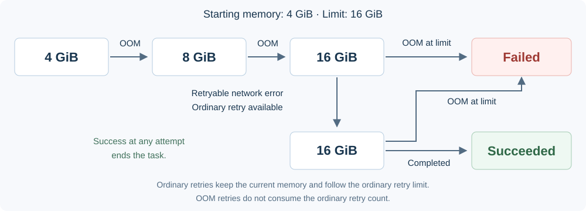
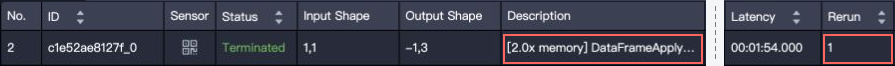
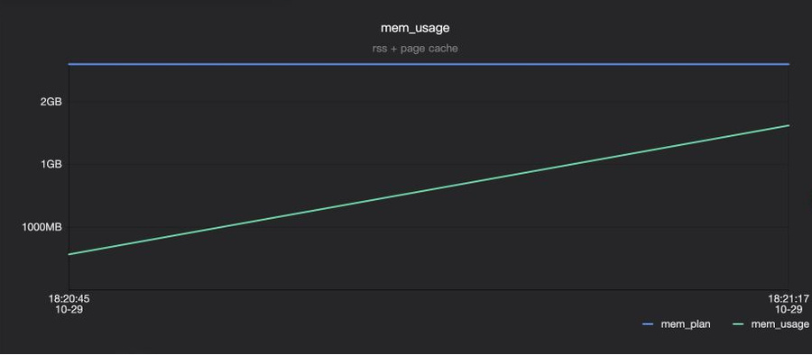
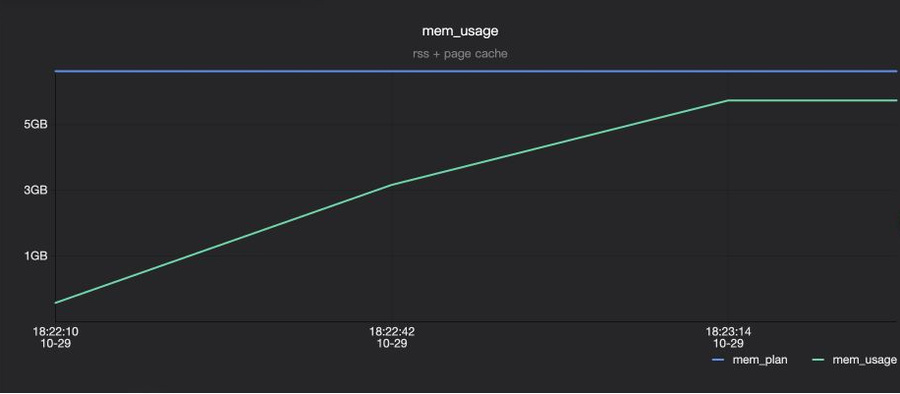

.. _user_guide_elastic_memory:

Using elastic memory
====================

Elastic memory lets DPE retry a CPU UDF task with more memory after an
out-of-memory (OOM) failure. It is useful when most tasks need little memory
but a few process much larger inputs.

When to use elastic memory
--------------------------

Variable-length payloads and large groups can make memory use uneven. Giving
every task the largest allocation reserves extra memory for ordinary inputs.
With a fixed quota, this can reduce the number of tasks running at once.
A large memory request can also increase the CPU request to meet the
memory-per-CPU ratio.

Use elastic memory for occasional OOM failures. If nearly every task needs
more memory, raise the starting ``memory`` or reduce the input size first.
Reducing ``batch_rows`` lowers temporary memory per function call, but does
not shrink the input chunk already held by the task. See :ref:`udf_tuning`.

.. _udf_elastic_memory_limits:

Supported tasks
~~~~~~~~~~~~~~~

The SDK and DPE runtime must support elastic memory, and the task must allow
retries. GU tasks, tasks with concurrency limits, and tasks scheduled together
through gang scheduling do not support it. It is also disabled when
``options.dpe.settings["step.skip_task_resources"] = True``.

Elastic memory can be used with CPU UDFs running on DPE, including the
following interfaces:

.. list-table::
   :header-rows: 1
   :widths: 45 55

   * - Operation
     - Interface
   * - Process DataFrame rows or columns
     - ``DataFrame.apply``
   * - Process Series elements
     - ``Series.apply``
   * - Process each DataFrame element
     - ``DataFrame.map`` / ``DataFrame.applymap``
   * - Process a DataFrame in batches
     - ``DataFrame.mf.apply_chunk``
   * - Process a Series in batches
     - ``Series.mf.apply_chunk``
   * - Process grouped data in batches
     - ``DataFrameGroupBy.mf.apply_chunk``
   * - Process a tensor in chunks
     - ``Tensor.mf.apply_chunk``

Configure memory
----------------

Set the starting ``memory`` and retry limit ``memory_limit`` in the same
``with_running_options`` decorator. For example, this UDF expands JSON arrays
stored in a ``payload`` column. Longer arrays produce more rows and temporary
objects, so batches can need different amounts of memory.

.. code-block:: python

   import json
   import pandas as pd
   from maxframe.udf import with_running_options

   @with_running_options(engine="DPE", memory="4GiB", memory_limit="16GiB")
   def expand_payloads(batch):
       records = batch["payload"].map(json.loads).explode()
       return pd.json_normalize(records)

These sizes illustrate the configuration; a short payload will not trigger
OOM. Size memory from representative inputs. To start at 8 GiB and allow up
to 32 GiB, change the decorator to ``memory="8GiB", memory_limit="32GiB"``.
Omitting ``memory`` uses the shared default, initially 4 GiB.

``memory_limit`` must be at least ``memory``. Equal values are valid and
disable expansion; a smaller limit raises an error. The cluster's available
resources also constrain the effective limit.

Shared defaults and per-function overrides
~~~~~~~~~~~~~~~~~~~~~~~~~~~~~~~~~~~~~~~~~~

To use the same elastic-memory settings for multiple DPE CPU UDFs, include
both ``memory`` and ``memory_limit`` in the shared defaults:

.. code-block:: python

   from maxframe.config import options

   options.function.default_running_options = {
       "cpu": 1,
       "memory": "4GiB",
       "memory_limit": "16GiB",
   }

Eligible DPE CPU UDF tasks then start with 4 GiB and can retry with up to
16 GiB. This setting does not select the execution engine. Assigning a new
dict replaces the previous defaults, so keep ``memory`` in the dict when
setting ``memory_limit``; otherwise each affected UDF must provide it in its
decorator.

.. _udf_config_elastic_overrides:

Override or disable a shared memory limit
^^^^^^^^^^^^^^^^^^^^^^^^^^^^^^^^^^^^^^^^^

``memory`` and ``memory_limit`` are inherited separately. With shared defaults
of ``memory="4GiB"`` and ``memory_limit="16GiB"``:

* ``@with_running_options(memory="8GiB")`` starts at 8 GiB and keeps the
  16 GiB limit.
* ``@with_running_options(memory="8GiB", memory_limit="8GiB")`` uses 8 GiB
  without elastic-memory retries for that UDF. Ordinary retries are unchanged.
* ``@with_running_options(memory="32GiB")`` fails validation because the
  inherited 16 GiB limit is below the new starting memory. Set a larger limit
  in the same decorator, or set ``memory_limit="32GiB"`` to disable expansion.

Passing ``memory_limit=None`` leaves the shared limit in effect. To remove a
shared limit for subsequent expressions, remove the key before building them:

.. code-block:: python

   from maxframe.config import options

   options.function.default_running_options.pop("memory_limit", None)

Configuration errors
~~~~~~~~~~~~~~~~~~~~

* ``memory must be specified when memory_limit is set``: set the starting
  ``memory`` in the decorator or shared defaults. Replacing the defaults with
  a dictionary containing only ``memory_limit`` removes the built-in memory.
* ``memory_limit must be greater than or equal to memory``: check the merged
  settings. Raising ``memory`` can leave an inherited limit below it. Set a
  supported limit at least as large as the starting memory.
* If a valid limit does not lead to expansion, follow
  :ref:`udf_elastic_memory_not_expanding`.

How retries work
----------------

When DPE classifies a failure as OOM, the next attempt requests
``min(current_memory * 2, memory_limit)``. A task that still runs out of memory
at the limit fails. Other errors follow ordinary retry rules and keep the
current memory allocation.

An error such as ``ExitError: signal: killed`` is a clue, not proof by itself.
Correlate the failure, memory metrics, and the next attempt's allocation.
See :ref:`udf_faqs` for OOM diagnosis.

Suppose the starting memory is 4 GiB and the limit is 16 GiB. The following
examples show how OOM retries and ordinary retries work together.

Example 1: a network error after memory expansion
~~~~~~~~~~~~~~~~~~~~~~~~~~~~~~~~~~~~~~~~~~~~~~~~~

This UDF needs 16 GiB to finish. The first two attempts run out of memory. The
third has enough memory, but fails with a retryable network error. There are
still ordinary retries available, so the task is tried again.

.. list-table::
   :header-rows: 1
   :widths: 20 25 55

   * - Attempt
     - Allocated memory
     - Result
   * - 1st
     - 4 GiB
     - OOM; retry with 8 GiB.
   * - 2nd
     - 8 GiB
     - OOM; retry with 16 GiB.
   * - 3rd
     - 16 GiB
     - Retryable network error; retry with the same memory.
   * - 4th
     - 16 GiB
     - Success; the task finishes.

The two OOM retries do not count toward the ordinary retry limit. The network
error causes one ordinary retry. That retry keeps the increased memory of 16
GiB: it neither falls back to 4 GiB nor increases it further.

Example 2: the memory limit is still not enough
~~~~~~~~~~~~~~~~~~~~~~~~~~~~~~~~~~~~~~~~~~~~~~~

This UDF needs 32 GiB to finish, but the configured limit is only 16 GiB.

.. list-table::
   :header-rows: 1
   :widths: 20 25 55

   * - Attempt
     - Allocated memory
     - Result
   * - 1st
     - 4 GiB
     - OOM; retry with 8 GiB.
   * - 2nd
     - 8 GiB
     - OOM; retry with 16 GiB.
   * - 3rd
     - 16 GiB
     - OOM at the limit; the task fails.

The third attempt has reached the 16 GiB limit and still runs out of memory.
The task fails instead of increasing memory to 32 GiB, even if ordinary
retries are still available.

These examples assume that enough resources are available and platform
protection rules do not stop retries earlier. Keep ordinary retries enabled to
handle temporary network or disk errors.

Resource use and repeated execution
~~~~~~~~~~~~~~~~~~~~~~~~~~~~~~~~~~~

Only the failed UDF task requests more resources. With the default maximum
ratio of 12 GiB per CPU, a task requesting one CPU and 16 GiB or 24 GiB is
adjusted to two CPUs. See :ref:`udf_tuning_resources` for the calculation and
the separate MCSQL CU setting.

A retry runs the function again. File writes, appended records, and external
requests must tolerate repeated execution. Expansion and retries consume
extra time and resources; they do not fix memory leaks or arbitrarily large
inputs.

.. _udf_elastic_memory_observation:

Verify the retry and choose memory sizes
----------------------------------------

Open ``session.get_logview_address()`` and find the UDF in DPE's **SubSteps**
list; the navigation is described in :ref:`udf_debugging_dpe`. After expansion,
**Description** includes a label such as ``[2.0x memory]``. The label compares
the new allocation with the starting memory. Check **Rerun**, task status,
and the failed and successful attempt records together.

The ratio can be fractional: expanding from 4 GiB to a 10 GiB limit produces
``[2.5x memory]``.

Run a deliberate OOM example
~~~~~~~~~~~~~~~~~~~~~~~~~~~~

The following one-row, one-partition example holds twelve 512 MiB arrays.
It starts with 4 GiB and allows 8 GiB, so the first attempt cannot hold all
6 GiB. The retry completes when the runtime and quota can supply enough memory.

.. warning::

   This example deliberately allocates 6 GiB and triggers an OOM. Run it in
   a test environment with capacity for an 8 GiB DPE task. Do not run it in
   Local Debug Mode.

Set the four connection environment variables before running the example.
Inside the UDF, DPE provides ``MAXFRAME_SUBSTEP_ATTEMPT`` as the zero-based
attempt number. Local Debug Mode does not provide this variable or run
elastic-memory retries.

.. code-block:: python

    import os
    import time

    import numpy as np
    import pandas as pd
    from odps import ODPS

    import maxframe.dataframe as md
    from maxframe.config import option_context
    from maxframe.session import new_session
    from maxframe.udf import with_running_options

    o = ODPS(
        os.environ["ALIBABA_CLOUD_ACCESS_KEY_ID"],
        os.environ["ALIBABA_CLOUD_ACCESS_KEY_SECRET"],
        project=os.environ["ODPS_PROJECT"],
        endpoint=os.environ["ODPS_ENDPOINT"],
    )

    @with_running_options(
        engine="DPE",
        memory="4GiB",
        memory_limit="8GiB",
    )
    def process_batch(batch):
        attempt = int(os.environ["MAXFRAME_SUBSTEP_ATTEMPT"])
        print(f"attempt={attempt}, allocating 6 GiB", flush=True)
        buffers = []
        time.sleep(20)  # Leave time for the first Sensor sample.
        for _ in range(12):
            block = np.empty(512 * 1024**2, dtype=np.uint8)
            block.fill(1)
            buffers.append(block)
            time.sleep(5)  # Make the growth visible between Sensor samples.

        print(f"attempt={attempt}, allocated_gib=6", flush=True)
        time.sleep(20)
        return batch.assign(
            allocated_gib=sum(block.nbytes for block in buffers) // 1024**3,
            attempt=attempt,
        )

    session = new_session(o)
    try:
        df = md.DataFrame(pd.DataFrame({"id": [1]}), num_partitions=1)
        result = df.mf.apply_chunk(
            process_batch,
            batch_rows=1,
            output_type="dataframe",
            dtypes={"id": "int64", "allocated_gib": "int64", "attempt": "int64"},
            index=df.index,
            skip_infer=True,
        )
        print(session.get_logview_address())
        with option_context({"local_execution.enabled": False}):
            result.execute(session=session)
        print(result.fetch(session=session))
    finally:
        session.destroy()

The UDF keeps twelve 512 MiB arrays in ``buffers`` and writes to every array
with ``fill(1)``. This uses real memory. It waits 20 seconds before allocation,
five seconds between arrays, and 20 seconds after allocation so that Sensor
can sample the growth. ``skip_infer=True`` prevents MaxFrame from calling the
UDF on the client to infer its output. Run this example on DPE, without local
debug mode.

The ``option_context`` block disables automatic local execution for this
submission. This keeps the small sample on DPE, where elastic retries run.
The verified run returned:

.. code-block:: text

       id  allocated_gib  attempt
    0   1              6        1

The task detail recorded the following attempts for SubStep
``c1e52ae8127f_0``. Attempt numbers start at zero. The memory column lists
the configured allocation for each attempt.

.. list-table::
   :header-rows: 1
   :widths: 18 18 22 42

   * - Attempt
     - Configured memory
     - Status
     - StdOut
   * - 0
     - 4 GiB
     - ``FAILED``
     - ``attempt=0, allocating 6 GiB``; no allocation-complete message.
   * - 1
     - 8 GiB
     - ``TERMINATED``
     - ``attempt=1, allocating 6 GiB`` followed by
       ``attempt=1, allocated_gib=6``.

The successful row has ``[2.0x memory]`` and **Rerun** ``1``. Together with the
failed attempt and the returned result, these verify the expansion from
4 GiB to 8 GiB. The attempt number alone does not identify an OOM retry.

The image combines the task and retry columns from the same row. The gap
marks omitted columns.

Choose the starting memory and limit
~~~~~~~~~~~~~~~~~~~~~~~~~~~~~~~~~~~~

Open **Sensor** on the UDF task's row. Under **Resource Basic Metrics**,
compare ``mem_usage`` with ``mem_plan``. **Mem Metrics** shows ``mem_rss``
and ``mem_cache`` separately. Check the task ID and time range so the curve
matches the attempt under investigation. See :ref:`logview_fuxi_sensor` for
metric meanings and the MCSQL entry point.

The following charts show the two attempts of this example in the user
Logview. The first is from the failed attempt, configured with 4 GiB.
Its last sample precedes the failure by about 12 seconds, so it does not
show memory usage at the moment of failure.

Sensor formats axis labels automatically, including MB and GB labels on the
same chart. Read each value together with its unit. The screenshots retain
the units displayed by Sensor; the configuration examples use GiB.

The second chart is from the successful retry, configured with 8 GiB. Usage
rises as the arrays are allocated, then levels off during the 20-second
hold. The ``[2.0x memory]`` label reports an allocation ratio; it is not a
measured memory peak.

Use representative inputs, including the largest payloads or groups. Choose
starting memory that covers normal tasks, then leave room for input, models,
intermediate objects, and output. Use larger successful tasks to estimate the
limit, within the available quota. A killed process's final sample can miss
its peak, so do not size the limit from that sample alone.

For example, suppose measurements across representative inputs show a
95th-percentile task peak of 3 GiB and a largest successful task peak of
6 GiB. Starting at 4 GiB with an 8 GiB limit leaves 1 GiB and 2 GiB of
headroom, respectively. These are trial settings for that workload, not a
fixed multiplier for every UDF. Validate them with larger inputs and the
actual runtime before using them for a full job.

With the default limit of 12 GiB per CPU, this 4-to-8 GiB example can keep
one CPU. A 16 GiB allocation needs at least ``ceil(16 / 12) = 2`` CPUs.
Both the starting allocation and retry limit must fit the available quota.
See :ref:`udf_tuning_resources`.

The deliberate OOM example above always holds 6 GiB of arrays. For a workload
where every task needs that much memory, start with a measured sufficient
allocation, such as 8 GiB for the verified run, instead of making every task
fail once at 4 GiB.

If most tasks need a retry, raise the starting memory or reduce their input.
If only a few keep failing at the limit, inspect those inputs for skew or a
memory leak before increasing the limit again. Repeated OOM failures at the
limit also warrant checking whether smaller chunks or batches reduce the
peak; see :ref:`udf_tuning`. A missing Sensor chart does not establish low
memory use.
