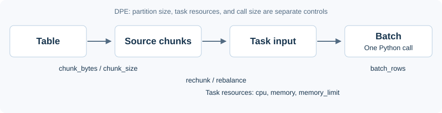

.. _user_guide_udf:

UDF User Guide
==============

A user-defined function (UDF) is a Python function for cleaning data, applying
business rules, or calling a model in a MaxFrame job. Functions such as
``map``, ``apply``, or ``apply_chunk`` apply the UDF to the data.

Use built-in expressions, string methods, or aggregations for calculations
they already support. Use a UDF for custom logic or calls to a third-party
library.

* Start with :ref:`udf_quick_start`, then see :ref:`udf_select_function` and
  :ref:`udf_examples` for other use cases.

* To run a job against a MaxCompute table, follow :ref:`udf_complete_example`.
  See :ref:`udf_configuration_guide` for resources and dependencies.

* For slow jobs or memory pressure, see :doc:`udf_tuning`.

* To inspect remote logs or step through a function locally, see
  :doc:`debugging`. For errors and incorrect results, see :doc:`faqs`.

.. _udf_quick_start:

Quick start
-----------

The following example converts two response-time values to numbers. The
function parses the ``ms`` suffix and returns a missing value for ``timeout``.
Set the MaxCompute credentials, project, and endpoint in the environment
variables used below before running the example.

.. code-block:: python

   import os
   import maxframe.dataframe as md
   from maxframe.session import new_session
   from odps import ODPS

   o = ODPS(
       os.environ["ALIBABA_CLOUD_ACCESS_KEY_ID"],
       os.environ["ALIBABA_CLOUD_ACCESS_KEY_SECRET"],
       project=os.environ["ODPS_PROJECT"],
       endpoint=os.environ["ODPS_ENDPOINT"],
   )
   session = new_session(o)
   values = md.Series(["12ms", "timeout"], name="latency_ms")

   def parse_latency(value):
       return float("nan") if value == "timeout" else float(value[:-2])

   try:
       result = values.map(parse_latency, dtype="float64")
       print(result.execute(session=session).fetch())
   finally:
       session.destroy()

.. code-block:: text

   0    12.0
   1     NaN
   Name: latency_ms, dtype: float64

.. _udf_core_concepts:

Core concepts
-------------

A *chunk* is one partition of a MaxFrame object. A *batch* is the rows passed
to one UDF call; one chunk can be processed in several batches. An execution
*task* processes data assigned by the engine and can handle one or more chunks.
MaxFrame supports three execution engines:
``DPE`` (distributed Python workers), ``MCSQL`` (MaxCompute SQL execution), and
``SPE`` (single-process Python execution).

The diagram describes DPE. A chunk boundary is not part of the UDF's contract;
batch sizes can change between executions. See :ref:`udf_tuning` for the
settings and their engine-specific behavior.

.. _udf_select_function:

Choose a function
-----------------

The main difference is what one function call receives and returns:

.. list-table::
   :header-rows: 1
   :widths: 24 40 36

   * - Input handled per call
     - Function
     - Typical use
   * - Process one value
     - ``Series.map`` / ``Series.apply`` / ``DataFrame.map``
     - Clean text or convert field values.
   * - Process one row or column
     - ``DataFrame.apply``
     - Combine fields in a record, or calculate over a column.
   * - Process a batch
     - ``DataFrame.mf.apply_chunk`` / ``Series.mf.apply_chunk``
     - Batch inference, vectorized processing, or batch requests.
   * - Expand one record into several
     - ``DataFrame.mf.flatmap`` / ``Series.mf.flatmap``
     - Split a document into paragraphs or a record into detail rows.
   * - Process a complete group
     - ``GroupBy.apply``
     - Use all records for one customer or fit a model per group.
   * - Process batches within a group
     - ``DataFrameGroupBy.mf.apply_chunk``
     - Apply a customer-specific rule or model to batches in that group.
   * - Transform, then aggregate by key
     - ``DataFrame.mf.map_reduce``
     - Define both the mapping and grouped reduction, such as word counting.
   * - Process array chunks
     - ``Tensor.mf.apply_chunk``
     - Apply NumPy or other numerical functions to array chunks.

Use ``GroupBy.apply`` when the calculation needs the complete group. Use
grouped ``apply_chunk`` when batches can be processed separately: a group can
be passed to the function in several calls.

See :ref:`udf_examples` for a short example of each interface.

.. _udf_configuration_guide:

Configure the UDF environment
-----------------------------

Use a decorator for one UDF and ``options`` for shared defaults. See
:doc:`udf_configuration` for engine support, common combinations, and precedence.
The :doc:`UDF API reference <../../reference/udf>` lists complete signatures
and parameters. See :doc:`elastic_memory` for DPE CPU UDF retries after OOM.
Before running a UDF, declare its output columns, dtypes, and index as described
in :ref:`udf_result_types`.

Next steps
----------

.. toctree::
   :maxdepth: 2

   examples
   complete_job
   result_types
   udf_configuration
   udf_tuning
   elastic_memory
   debugging
   faqs
