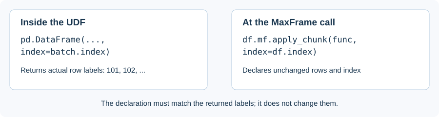

.. _udf_result_types:

Declaring result types
======================

Why declare return types
------------------------

Before a job runs, MaxFrame needs the UDF result type: DataFrame, Series,
or array. Its columns, dtypes, and index describe the input for later operations.

Without a return declaration, interfaces that support inference may call the
function on the client with made-up sample data. Ungrouped ``apply_chunk``
normally receives one sample row; grouped functions receive sample groups.
This happens before ``execute()`` and really runs the function. Model loading,
file access, and external requests inside it can therefore happen on the
client, or fail because the sample values or local environment are unsuitable.

Declare the result when the function uses external services, remote files, or
large models. The declaration does not convert the returned values. The actual
pandas or NumPy result must match it, including branches that return no rows.

Choose how to describe the result
---------------------------------

The usual choices are:

.. list-table::
   :header-rows: 1
   :widths: 28 38 34

   * - Method
     - When to use
     - Client-side trial call
   * - Return type annotation
     - The function can be edited, its return type is fixed, and the interface
       supports annotations.
     - A complete annotation avoids the trial call only on interfaces that
       read it. See the exceptions below.
   * - Explicit type arguments
     - The function comes from a shared library, its output columns are computed
       dynamically, or a static type checker is used.
     - Complete type arguments avoid inference. ``skip_infer=True`` makes the
       choice explicit on interfaces that support it.
   * - Automatic type inference
     - A short experiment with a lightweight function that handles synthetic
       input and has no external side effects.
     - The function runs locally while the expression is built.

The DataFrame and Series examples below share this sample dataset, where ``id``
is stored as the DataFrame ``index``:

.. code-block:: python

   import numpy as np
   import pandas as pd
   import maxframe.dataframe as md

   pdf = pd.DataFrame(
       {
           "customer": ["A", "B"],
           "price": [5.0, 8.0],
           "quantity": [2, 3],
       },
       index=pd.Index([101, 102], name="id"),
   )
   df = md.DataFrame(pdf)

The output blocks show results fetched from a configured MaxFrame session.
For example, ``totals_df.execute().fetch()`` runs the first example below.

1. Return type annotations
~~~~~~~~~~~~~~~~~~~~~~~~~~

For DataFrame and Series ``mf.apply_chunk``, write the return type after ``->``.
These interfaces read a complete annotation without calling the function.
Scalar annotations such as ``-> float`` also work with ``Series.map``.

Other interfaces have different rules:

* ``GroupBy.apply`` still makes a trial call when only a return annotation
  is provided. Pass explicit result type arguments to avoid it.
* ``DataFrame.apply`` does not parse ``pd.DataFrame[...]`` batch annotations.
  Declare ``output_type`` and ``dtypes`` or ``dtype`` on the call.
* String annotations, including those produced by
  ``from __future__ import annotations``, are not resolved, as explained below.

.. warning::

   With ``from __future__ import annotations``, return annotations are stored
   as strings. MaxFrame does not currently resolve these strings and may
   mistake a DataFrame result for a Series. When calling ``mf.apply_chunk``
   in these modules, pass ``output_type``, ``dtypes`` / ``dtype``, and
   ``skip_infer=True`` explicitly. See :ref:`udf_explicit_return_types` for
   examples.

.. note::

   Subscripted annotations such as ``pd.DataFrame[{"total": "float64"}]``,
   ``pd.DataFrame[{"id": "int64"}, {"total": "float64"}]``, and
   ``pd.Series["score": "float64"]`` are MaxFrame extensions to pandas type
   annotations. Static type checkers such as ``mypy`` or ``pyright`` may report
   them as invalid. :ref:`Explicit type arguments <udf_explicit_return_types>`
   provide an alternative compatible with these type checks.

**DataFrame result**

Pass a single dict ``pd.DataFrame[{col: dtype, ...}]`` to declare output
columns, or two dicts ``pd.DataFrame[{index_name: index_dtype}, {col: dtype, ...}]``
to declare both the output index and output columns:

.. code-block:: python

   def compute_totals(chunk: pd.DataFrame) -> pd.DataFrame[
       {"id": "int64"},
       {"total": "float64", "discounted": "float64"},
   ]:
       totals = (chunk["price"] * chunk["quantity"]).to_numpy()
       return pd.DataFrame(
           {"total": totals, "discounted": totals * 0.9},
           index=chunk.index,
       )

   totals_df = df.mf.apply_chunk(compute_totals)

.. code-block:: text

        total  discounted
   id
   101   10.0         9.0
   102   24.0        21.6

With the single-dict form, pass ``index=df.index`` to ``apply_chunk`` when the
function keeps all input rows in the same order. The two-dict form above also
declares the index name and type.

**Series result**

.. code-block:: python

   def normalize(values: pd.Series) -> pd.Series["score": "float64"]:
       return values.astype("float64").rename("score")

   normalized = df["price"].mf.apply_chunk(normalize, index=df.index)

.. code-block:: text

   id
   101    5.0
   102    8.0
   Name: score, dtype: float64

In ``pd.Series["score": "float64"]``, ``"score"`` is the Series ``name`` (not
its index name, which remains ``"id"``) and ``"float64"`` is its value dtype. If
both a return annotation and explicit keyword arguments are provided, the
keyword arguments take precedence.

.. _udf_explicit_return_types:

2. Explicit keyword arguments and ``skip_infer=True``
~~~~~~~~~~~~~~~~~~~~~~~~~~~~~~~~~~~~~~~~~~~~~~~~~~~~~

Use keyword arguments when the function signature cannot be modified or when
output columns are constructed dynamically. On ``mf.apply_chunk``, set
``skip_infer=True`` alongside the type arguments so MaxFrame does not run a
client-side trial call (``skip_infer=True`` alone does not replace ``dtypes`` or
``dtype``):

.. code-block:: python

   def build_order_totals(chunk: pd.DataFrame):
       return pd.DataFrame(
           {"total": chunk["price"].astype("float64") * chunk["quantity"]},
           index=chunk.index,
       )

   order_totals = df.mf.apply_chunk(
       build_order_totals,
       output_type="dataframe",
       dtypes={"total": "float64"},
       index=df.index,
       skip_infer=True,
   )

.. code-block:: text

        total
   id
   101   10.0
   102   24.0

For a Series result, pass ``output_type="series"``, ``dtype="float64"``,
``name="score"``, ``index=df.index``, and ``skip_infer=True``.

3. Automatic type inference
~~~~~~~~~~~~~~~~~~~~~~~~~~~

When neither a return annotation nor explicit type arguments are given,
MaxFrame calls the function on synthetic input to inspect its result:

.. code-block:: python

   def calculate_total(chunk):
       return chunk.assign(total=chunk["price"] * chunk["quantity"])

   totals = df.mf.apply_chunk(calculate_total)

.. code-block:: text

       customer  price  quantity  total
   id
   101        A    5.0         2   10.0
   102        B    8.0         3   24.0

Use automatic inference only for side-effect-free functions whose output schema
never depends on actual data values.

.. _udf_result_index:

Keep the result index consistent
--------------------------------

For one output row per input row, keep the original row labels. When a UDF
builds a pandas DataFrame or Series from NumPy arrays or lists, pass
``index=batch.index`` inside the function. Otherwise, each batch starts its
index at zero, so different batches can produce repeated labels.

The ``index=df.index`` argument on ``apply_chunk`` has a different purpose:
it describes the result to MaxFrame before execution. It does not replace the
index of the pandas object returned by the function. Use it only when all
input rows and their order are preserved.

If the function filters, expands, or reorders rows, return the corresponding
index from the function and declare its names and types. For example,
``pd.DataFrame[{"id": "int64"}, {"total": "float64"}]`` declares an integer
``id`` index without claiming that every input row remains. Omitting an index
declaration can make MaxFrame fall back to the input index type and emit a
warning; it does not make an incorrect returned index safe.

For ``GroupBy.apply`` and ``DataFrameGroupBy.mf.apply_chunk``, pass
``prepend_index_group_keys=True`` explicitly to use the group-index behavior
in :ref:`udf_group_index`. With ``True`` and
the usual ``group_keys=True``, an ``id`` index becomes a
``MultiIndex (customer, id)`` when grouping by customer.
Declare only the function's own index and columns, since MaxFrame adds the
group level. See :ref:`udf_group_index` for a complete example.

For ``map_reduce``, use ``ignore_index=True`` when the final row labels do not
need to be preserved. It resets the result index; it is not an argument shared
by all UDF interfaces.

Quick reference by UDF interface
--------------------------------

The table below summarizes how the UDF interfaces handle return type
declarations, automatic inference, and row indexes:

.. list-table::
   :header-rows: 1
   :widths: 24 28 24 24

   * - Interface
     - Return declaration
     - Auto-inference constraints
     - Row ``index`` behavior
   * - ``Series.map`` / ``Series.apply``
     - ``dtype=...`` or scalar annotation ``-> float`` (``Series.map``);
       ``output_type="dataframe"`` + ``dtypes=...`` when ``Series.apply``
       expands into columns.
     - ``Series.map`` **disallows** auto-inferring ``int`` return values (raises
       an error unless ``dtype`` or annotation is provided).
     - Always inherits the input Series index.
   * - ``DataFrame.map``
     - ``dtypes={...}`` per column or ``dtype=...`` for all columns.
     - Uses a small sample for a trial call if omitted.
     - Always preserves the input DataFrame shape and index.
   * - ``DataFrame.apply``
     - ``output_type="series"`` + ``dtype`` / ``name``, or
       ``output_type="dataframe"`` + ``dtypes``.
     - Infers via trial call if omitted; does not parse ``pd.DataFrame[...]``
       batch annotations.
     - With ``axis=1``, preserves the input row index. With ``axis=0``, a Series
       result uses column names as its index; a DataFrame result uses the
       index returned by the function.
   * - ``DataFrame.mf.apply_chunk`` / ``Series.mf.apply_chunk``
     - ``-> pd.DataFrame[...]`` / ``-> pd.Series[...]``, or ``output_type`` +
       ``dtypes`` / ``dtype`` / ``name`` + ``skip_infer=True``.
     - Uses a one-row trial call when the result type is missing and inference
       is enabled.
     - Keeps each batch's returned row labels. Use ``index=batch.index`` inside
       the function to preserve them; the outer ``index=...`` only declares
       the result index to MaxFrame.
   * - ``DataFrame.mf.flatmap`` / ``Series.mf.flatmap``
     - DataFrame requires ``dtypes={...}``. Series requires ``dtypes={...}``
       (rows) or ``dtype=...`` (scalars).
     - **Never auto-infers**; omitting ``dtypes`` / ``dtype`` raises an error
       immediately.
     - Automatically repeats the source row's index label for every emitted row
       or value.
   * - ``GroupBy.apply``
     - ``output_type`` + ``dtypes`` (or ``dtype`` / ``name``).
     - Runs a multi-row trial call if type arguments are omitted. Return
       annotations alone do not avoid this call in the current implementation.
     - With ``prepend_index_group_keys=True``, prepends group keys to the inner
       index to form a ``MultiIndex``. Declare only the function's own return
       columns/index.
   * - ``DataFrameGroupBy.mf.apply_chunk``
     - ``-> pd.DataFrame[...]`` / ``-> pd.Series[...]``, or explicit
       ``output_type`` + ``dtypes`` / ``dtype``.
     - Uses sample groups when the result type is missing and inference is
       enabled.
     - Same ``prepend_index_group_keys=True`` rule as ``GroupBy.apply``; pass
       ``index=batch.index`` inside the function to keep row alignment.
   * - ``DataFrame.mf.map_reduce``
     - ``mapper_dtypes={...}`` and ``reducer_dtypes={...}`` (or stage return
       annotations). With ``combiner``, explicitly set ``mapper_dtypes``;
       the mapper's return annotation is not retained.
     - Infers stage schemas via trial calls if omitted.
     - Use ``mapper_index`` / ``reducer_index``, or ``ignore_index=True`` to
       reset the final index.
   * - ``Tensor.mf.apply_chunk``
     - ``dtype=...`` and, when known, ``shape=...`` (or ``elementwise=True``).
     - Infers ``dtype`` from a dummy array call if omitted; does not use
       ``skip_infer``.
     - Operates on N-dimensional array blocks (no pandas index).

Interface-specific declarations
-------------------------------

The :ref:`UDF examples <udf_examples>` show each operation and its result.
Use the table above to choose the declaration. These cases need extra care:

* ``Series.map`` returning an integer needs ``dtype="int64"`` or a scalar
  return annotation such as ``-> int``.
* ``GroupBy.apply`` needs explicit type arguments to avoid a trial call, even
  when the same function works with annotations in grouped ``apply_chunk``.
* With a ``map_reduce`` combiner, set ``mapper_dtypes`` explicitly. The wrapper
  combining mapper and combiner does not retain the mapper's return annotation.

.. _udf_tensor_return:

Tensor results
~~~~~~~~~~~~~~

For ``Tensor.mf.apply_chunk``, use ``dtype`` for the element type and ``shape``
for the complete output shape when known. Tensor results have no pandas index
and do not use pandas return annotations or ``skip_infer``.
For an elementwise operation that preserves shape, use ``elementwise=True``;
see the array example in :ref:`udf_examples`.
