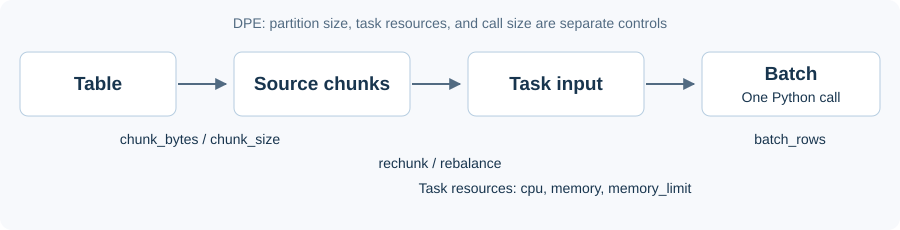

.. _udf_tuning:

Tuning UDF workloads
====================

When a UDF job is slow or runs out of memory, tune the input partitions, batch
size, and task resources separately.

In DPE, input data and function calls are divided as follows:

Chunk settings control the input assigned to tasks and can affect parallelism.
``with_running_options`` requests resources for each UDF task. ``batch_rows``
limits one function call, which can reduce its temporary objects, but does not
remove the input already held by the task. A model loaded in the task also
continues to occupy memory between calls.

Chunk sizes are not guaranteed to be consistent between executions of the
same job. Choose settings according to memory use and observed performance;
do not rely on a previous run's chunk boundaries for correct results.

The diagram describes DPE. SQL execution has different partitioning rules;
the table below lists which settings each engine supports.

Choose the next adjustment
--------------------------

First identify the expensive or failed UDF task in :ref:`udf_debugging`.
Then choose the control that matches the symptom:

.. list-table::
   :header-rows: 1
   :widths: 25 25 25 25

   * - Symptom
     - Check
     - Adjust first
     - Limitation
   * - Memory grows with task input
     - Input rows/bytes and largest groups
     - Source chunks or repartitioning
     - Smaller source chunks do not split a complete group.
   * - Temporary objects fill memory during a batch
     - Per-call input and intermediate objects
     - ``batch_rows``
     - Does not remove task input or a loaded model.
   * - A few tasks exceed normal memory use
     - Failed attempt and retry history
     - DPE elastic memory
     - Cannot fix a leak or exceed the configured limit.
   * - Most tasks need more memory
     - Typical peak and persistent model size
     - Starting ``memory`` or input size
     - Repeated OOM retries waste time and resources.
   * - CPU limits throughput
     - CPU use and available parallel tasks
     - Partitions or per-task ``cpu``
     - More CPUs do not parallelize a Python loop automatically.

For MCSQL Fuxi workers, compare ``mem_usage`` with ``mem_plan`` in
:ref:`logview_fuxi_sensor`. For DPE, use the relevant SubStep's Sensor entry
when available, and correlate its attempt with StdOut/StdErr. A missing
Sensor chart is not evidence of low memory use.

Use representative data to compare normal tasks with the largest tasks.
Leave room for input data, models, temporary objects, and output. Change one
setting at a time, then compare peak memory, duration, and resource usage.
An OOM-killed process's final sample can miss its peak; do not size memory
from that sample alone.

The controls below apply to different interfaces from
:ref:`udf_select_function`:

.. list-table::
   :header-rows: 1
   :widths: 27 43 30

   * - What to adjust
     - Example
     - Effect
   * - Byte-based table splits
     - ``md.read_odps_table(..., chunk_bytes=16 * 1024**2)``
     - In DPE, targets source chunks by bytes. In MCSQL, sets the SQL
       ``split_size`` hint. SPE ignores this parameter.
   * - Row-based table splits
     - ``md.read_odps_table(..., chunk_size=256)``
     - In DPE, targets rows per source chunk for transactional tables or reads
       with ``nrows``. MCSQL and SPE ignore this parameter.
   * - Rows per existing chunk
     - ``df.rechunk({0: 1000})``
     - Sets the target number of rows per chunk. For DataFrame and Series, this
       is effective only in DPE.
   * - Number of existing chunks
     - ``df.mf.rebalance(num_partitions=10)`` or
       ``df.mf.rebalance(factor=2.0)``
     - Uses an upper limit of ten chunks, or targets twice the current chunk
       count.
   * - Rows passed to one batch UDF call
     - ``batch_rows=1000``
     - Limits each batch call without changing the input chunks. Supported by
       DataFrame, Series, and DataFrameGroupBy ``mf.apply_chunk``, and
       DataFrame ``mf.map_reduce``.
   * - Resources for one UDF task
     - ``@with_running_options(cpu=2, memory="8GiB")``
     - Requests CPU and memory for each task, independently of its call count.
   * - Memory limit for OOM retries
     - ``@with_running_options(memory="4GiB", memory_limit="16GiB")``
     - For eligible DPE CPU UDF tasks, starts at 4 GiB and allows OOM retries
       with up to 16 GiB. Does not change input chunks or batch sizes.

.. _udf_tuning_resources:

Request resources with with_running_options
-------------------------------------------

Import ``with_running_options`` from ``maxframe.udf`` and place
``@with_running_options(...)`` before the UDF definition, before building the
MaxFrame expression that uses it. Resources are requested by each task running
the function.

The following example extracts latency values from log messages in batches.
Each task running ``parse_latency`` requests two CPUs and 8 GiB of memory,
while each function call receives at most 1,000 rows:

.. code-block:: python

   import maxframe.dataframe as md
   import pandas as pd
   from maxframe.udf import with_running_options

   @with_running_options(cpu=2, memory="8GiB")
   def parse_latency(batch):
       values = batch["raw_log"].str.extract(r"latency=(\d+(?:\.\d+)?)ms")[0]
       latency = pd.to_numeric(values, errors="coerce").astype("float64")
       return batch[["id"]].assign(latency_ms=latency, is_slow=latency >= 500)

   df = md.DataFrame({"id": [1, 2], "raw_log": ["latency=12.5ms", "latency=800ms"]})
   result = df.mf.apply_chunk(
       parse_latency,
       batch_rows=1000,
       output_type="dataframe",
       dtypes={"id": "int64", "latency_ms": "float64", "is_slow": "bool"},
       index=df.index,
   )

``cpu=2`` requests two CPUs per task. ``memory="8GiB"`` requests 8 GiB per
task; an integer such as ``memory=8`` also means GiB. These values are example
requests, not recommended defaults for every UDF. Account for the input data,
loaded models, intermediate objects, and output data when choosing memory.

With the default ``options.function.allowed_max_memory_cpu_ratio=12``, the
CPU request is raised when memory exceeds 12 GiB per CPU. The adjusted count
is ``ceil(memory_GiB / 12)`` when that is larger than the requested count.
For example, ``cpu=1`` with 16 GiB or 24 GiB is adjusted to two CPUs.

MCSQL calculates its CU setting separately:
``max(cpu, ceil(memory_GiB / 4), 1)``. Thus the two examples request 4 and
6 CU respectively, not 2 CU. This is a resource setting, not an estimate of
the final bill. Compare actual duration and quota usage after adjusting it.

If most tasks fit in the starting memory and only a few need more, add
``memory_limit`` to the same decorator. Eligible DPE CPU UDF tasks can then
retry after an OOM with more memory. See :ref:`udf_config_elastic_memory`
for the configuration. If most tasks already need more memory, raise
``memory`` or reduce their input instead of repeatedly paying the retry cost.

Attach ``with_running_options`` to the callable passed to ``map``, ``apply``,
``flatmap``, ``GroupBy.apply``, or DataFrame, Series, grouped, and Tensor
``apply_chunk``. For example, configure the function passed to ``Series.map``
in the same way:

.. code-block:: python

   import maxframe.dataframe as md
   from maxframe.udf import with_running_options

   @with_running_options(cpu=2, memory="8GiB")
   def scale_value(value):
       return float(value) * 0.1

   values = md.Series([10.0, 20.0])
   mapped = values.map(scale_value, dtype="float64")

Here the function still receives one value per call. The CPU and memory
requests apply to the task running those calls, not to each value. Raising
``cpu`` does not automatically parallelize a Python loop; extra CPUs help only
when the computation can use them, for example through a parallel library.

Without ``engine``, MaxFrame follows the job's engine selection. To select DPE
for one UDF, pass ``engine="DPE"`` in ``with_running_options``.
MCSQL also maps CPU and memory
requests to its UDF worker settings; do not assume its SQL tasks have DPE chunk
semantics.

For ``map_reduce`` without a combiner, decorate the mapper and reducer
separately to configure their stages. With a combiner, use shared defaults
from :ref:`udf_config_default_resources` for the combined mapper stage; its
resources cannot be reliably set with the mapper or combiner decorator alone.

Use one ``with_running_options`` decorator per UDF, combining the engine and
resource settings in that decorator. Stacking it can lose the inner settings.
A field omitted from the decorator inherits its shared default. For shared
settings, GPU requests, and memory-per-CPU constraints, see
:ref:`udf_config_resources`, :ref:`udf_config_default_resources`, and
:ref:`udf_config_precedence` rather than copying every configuration into the
UDF.

.. _udf_source_chunk_settings:

Set chunks when reading a table
-------------------------------

Set ``chunk_bytes`` and ``chunk_size`` in
:func:`maxframe.dataframe.read_odps_table` to adjust source chunks for subsequent
``map``, ``apply``, ``flatmap``, or ``apply_chunk`` operations. Replace the
table names below with tables that have ``id`` and ``raw_log`` columns.

Their behavior depends on the execution engine:

* DPE uses ``chunk_bytes`` for non-transactional tables read without ``nrows``.
  Its default target is 64 MiB.
* DPE uses ``chunk_size`` for transactional tables or reads with ``nrows``.
  Its default is ``options.chunk_size`` when configured, otherwise 1,024 rows.
* MCSQL converts an explicitly set ``chunk_bytes`` value to a SQL
  ``split_size`` hint and ignores ``chunk_size``.
* SPE ignores both parameters.

The following examples reuse ``parse_latency`` from the resource example.
This DPE example requests a smaller 16 MiB source chunk:

.. code-block:: python

   df = md.read_odps_table(
       "source_table",
       chunk_bytes=16 * 1024**2,
   )
   result = df.mf.apply_chunk(
       parse_latency,
       output_type="dataframe",
       dtypes={"id": "int64", "latency_ms": "float64", "is_slow": "bool"},
       index=df.index,
   )

``chunk_bytes`` sets a target size for source chunks; the actual sizes and
number of chunks may vary. A 16 MiB source chunk does not mean the pandas
object received by the function uses 16 MiB of memory.

For a transactional table or a read limited by ``nrows``, this DPE example
reduces the target row count to 256:

.. code-block:: python

   df = md.read_odps_table(
       "transactional_table",
       chunk_size=256,
   )
   result = df.mf.apply_chunk(
       parse_latency,
       output_type="dataframe",
       dtypes={"id": "int64", "latency_ms": "float64", "is_slow": "bool"},
       index=df.index,
   )

If later operations repartition the DataFrame, downstream UDFs use the data
produced by those operations. Grouping can bring rows with the same key
together again, so smaller source chunks do not bound the size of a group.

Adjust existing chunks
----------------------

To change the number of rows per chunk, use ``rechunk``. The adjustment is not
specific to ``apply_chunk``; this example uses a scalar UDF on a table with a
``value`` column:

.. code-block:: python

   import maxframe.dataframe as md

   def scale_value(value):
       return float(value) * 0.1

   df = md.read_odps_table("source_table")
   adjusted = df.rechunk({0: 1000})
   result = adjusted["value"].map(scale_value, dtype="float64")

Here ``0`` selects the row axis and ``1000`` is the target row count. DataFrame
and Series ``rechunk`` is currently effective only in DPE.

To change the number of chunks, use ``rebalance``:

.. code-block:: python

   ten_or_fewer_chunks = df.mf.rebalance(num_partitions=10)
   twice_as_many_chunks = df.mf.rebalance(factor=2.0)

* ``num_partitions=10`` produces at most ten chunks.
* ``factor=2.0`` targets twice the current chunk count; ``factor=0.5`` targets
  half. DPE rounds the target to the nearest integer and keeps at least one
  chunk.

Do not specify ``num_partitions`` and ``factor`` together. These examples use
the default ``axis=0``, which adjusts row chunks.

Both operations reorganize the data and add execution overhead. Choose
``rechunk`` for rows per chunk or ``rebalance`` for the chunk count, and make
the adjustment once before the UDF operation that needs it. More partitions
can expose more work for DPE to schedule, but do not guarantee more concurrent
tasks: available resources and the execution plan also matter.

.. _udf_batch_rows:

Set the size of one function call
---------------------------------

For DataFrame and Series ``apply_chunk``, use ``batch_rows`` to limit the
number of rows passed to each Python call:

.. code-block:: python

   df = md.read_odps_table("source_table")
   result = df.mf.apply_chunk(
       parse_latency,
       batch_rows=1000,
       output_type="dataframe",
       dtypes={"id": "int64", "latency_ms": "float64", "is_slow": "bool"},
       index=df.index,
   )

If a DPE input chunk contains 2,500 rows, this example calls ``parse_latency``
three times with 1,000, 1,000, and 500 rows. Reducing ``batch_rows`` can reduce
temporary memory inside each call without changing the input chunk or creating
more tasks.

When ``batch_rows`` is omitted for ungrouped ``apply_chunk``, DPE passes each
input chunk to the function in one call. MCSQL uses batches of up to 1,024 rows
by default.

Choose batching controls according to the interface:

.. list-table::
   :header-rows: 1
   :widths: 35 65

   * - Interface
     - Call size and tuning
   * - ``map``, ordinary ``apply``, and ``flatmap``
     - The UDF receives one value or row, or the column selected by ``axis``.
       These interfaces do not expose a ``batch_rows`` control. Tune task
       resources and input partitions instead; for a library that accepts
       batches, consider ``apply_chunk``.
   * - DataFrame / Series ``mf.apply_chunk``
     - Use ``batch_rows`` for rows per call, independently of source chunks
       and task resources.
   * - ``DataFrameGroupBy.mf.apply_chunk``
     - Use ``batch_rows`` to set the maximum rows per call within a group.
       In DPE, the task receives the group data before calling the function
       in batches.
   * - ``DataFrame.mf.map_reduce``
     - ``batch_rows`` applies to both stages. Use ``mapper_batch_rows`` and
       ``reducer_batch_rows`` to tune their call sizes separately.
   * - ``GroupBy.apply``
     - The function receives the entire group; there is no ``batch_rows``
       control. Input rechunking does not split one group into independent
       groups.
   * - ``Tensor.mf.apply_chunk``
     - The function receives one input Tensor chunk; there is no
       ``batch_rows`` control. Adjust Tensor chunks instead.

For ``map_reduce``, the common ``batch_rows`` default is 1,024. A stage-specific
value overrides it; leaving ``mapper_batch_rows`` or ``reducer_batch_rows`` as
``None`` inherits the common value rather than disabling batching. The
word-count example in :ref:`udf_examples` demonstrates mapper and reducer
calls, including the MCSQL reducer's final-batch ``end=True`` protocol. Preserve
that protocol when changing reducer batch sizes.

For ``df.groupby(...).mf.apply_chunk``, a group may arrive in several batches.
If the calculation needs every row of a group at once, use ``GroupBy.apply``.
In DPE, reducing the grouped batch size can reduce per-call temporary objects,
but does not eliminate the memory occupied by the group data. A very large
group can still exhaust memory; check group sizes rather than assuming that
smaller source chunks or batches fix skew.

For ``Tensor.mf.apply_chunk``, set ``chunk_size`` when creating a Tensor, or use
``t.rechunk(...)``. The function is called once per input Tensor chunk. Preserve
the array semantics when changing chunk boundaries.
